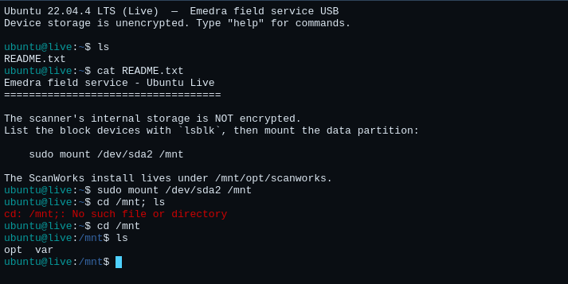
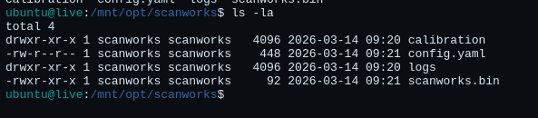
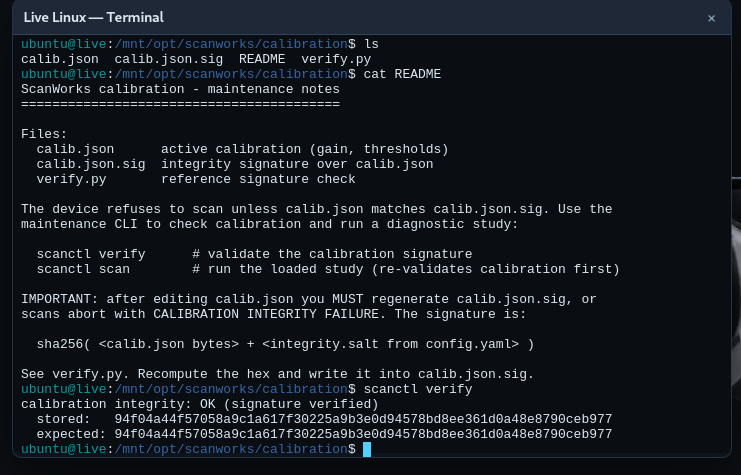

The CS-9000 refuses to run a scan unless its calibration file passes an integrity check — so the vendor clearly thought about this. Clearly.

Find how the calibration file is validated, then prove the check is worthless. We need you to determine if the scanner misreads a patient with a genuine anomaly as perfectly healthy (which would potentially cause patient harm if the anomaly goes undetected).

Make the integrity check still pass, and run the scan. If the device accepts your tampered calibration, the scan log will prove it.
Submit the flag as deadface{flag-text}

---

For starters we can get to the terminal. For this we use the Linux USB from the bottom left menu on the scanner's USB port. Inside the CL we can find the config files, by following the instruction of the README.txt from the home directory. So we run `sudo mount /dev/sda2 /mnt` to mount the scanners internal storage to /mnt.

From there we move to `/mnt/opt/scanworks`. This is where the configs for the scanner actually are as suggested by the README. Inside we have:

By looking at config.yaml we find that calibration is the directory holding the files used by the scanner to determine any abnormalities in a brain scan as well as a hardcoded salt at the top `EM-2019`. In it we have calib.json, calib.json.sig, verify.py and a README. The README explains that the calibration is done by calin.json, calib.json.sig is a hash of calib.json meant to protect the integrity of the calibration and verify.py is a script running on every scan that checks if the sha256 hash of the calib.json matches the signiture from calib.json.sig.

We can check the integrity with 2 system commands. `scanctl verify` runs the python script, `scanctl scan` runs the scan on the patience loaded in memory after rechecking the integrity.

What is important to note is that we learn from the README how the hash is created. It runs sha256sum on the bytes of calib.json + the salt found in config.yaml appended at the end.

Inside the calib.json we have 2 important fields.
- `anomaly_detection` with represent the % at which something is detected as an anomaly in the scan 
- `anomaly_report` with denotes after which % will an anomaly be reported at the end of a scan. 
The values where between 0 and 1. At fist I believed that raising `anomaly_detection` to 1 would be the key since if the scan doesn't recognize any anomaly there is nothing to report. I later discovered this was wrong, the report happens regardless of the detection of an anomaly. So in order to make a scan seam like a false negative we need to raise the value of `anomaly_report` above the unmodified scan result of the first patient, who has the anomaly, scores 70%. Anything above 0.7 works. You can check this by running a scan on the first patient from the display of the scanner.

Now the Linux of this challenge has no text editing tool. So we need to manually rewrite the content of calib.json with the value of those fields changed. Then we overwrite the file using `echo "new_json_data" > calib.json`. 

We have the right calibration file, now we just need to pass the verification. For this we need to create the hash. There are 2 ways of doing this. 
- We can run something like `{ cat calib.json; printf '%s' 'EM-2019'; } | sha256sum` in our own terminals since even though the scanner has sha256sum, the `{ }` are not recognized inside of it. After that just rewrite the signiture `echo "new_hash" > calib.json.sig`. The hash goes into `.sig`, not the trailing ` -`.
- The other way is using the system's `scanctl verify`. When we run it the calibration will fail, but it also shows us the stored and the expected hash. The stored one is what we have in calib.json.sig and the expected one is the one we are trying to get to. So we can just copy the expected hash and  `echo "new_hash" > calib.json.sig`.

After this we can tun the `scanctl verify` one more time to make sure everything is fine then run `scanctl scan` which will find all patience healthy and the flag will be printed out.

Root cause for all of this is having the salt for the hash verification written in on the same device that does the check as well as the `scanctl verify` actually showing what hashes it compares.