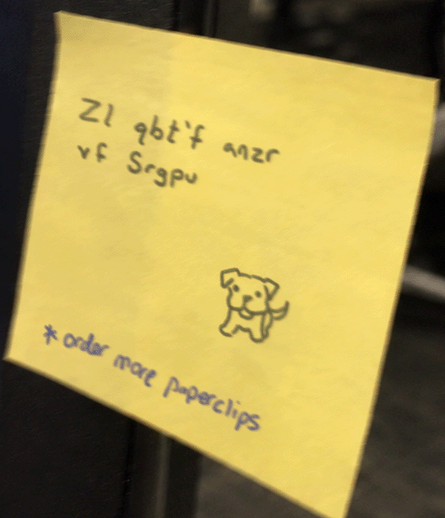

One of the faculty at Night Veil University thought it would be clever to write sensitive information on notes by their computer. This sensitive information includes a very easy-to-decipher password hint. Judging by the drawing of a dog on the photo, we assume the password hint is the name of the individual's dog.

Submit the flag with the dog's name as: deadface{dog's name}

---

We are presented with this picture:



Going by the name of the challenge, “Hail Caesar”, the text presented in the photo `Zl qbt'f anzr vf Srgpu` is most probably encoded with Caesar’s Cipher. We can get a hint of this by looking at the text’s structure. The length and form of the words are very English-like, and one of the words even has a `'`. Spaces are also present. Taking all of this into account, we are looking for an algorithm that keeps the text’s original structure but switches the letters around.

To decode it we can use tools like CyberChef. The ROT13 Brute Force operation (equivalent to brute-forcing Caesar’s cipher) gives us the results for all 25 possible keys. Looking for the only readable text, we find the answer `My dog's name is Fetch`, with the key 13. We are looking for the dog’s name, so the flag ends up being `deadface{Fetch}`.

The root cause is leaving sensitive information for all to see. A Caesar cipher is technically encryption, but with only 25 possible keys it doesn't protect anything.

If you don’t like tools like CyberChef, you can also solve the cipher with some Python.
```python
text = "Zl qbt'f anzr vf Srgpu"
for i in range(1, 26):
    copy = text
    answer = ""
    for letter in copy:
        if letter.islower():
            letter = chr((ord(letter) - ord("a") + i) % 26 + ord("a"))
        elif letter.isupper():
            letter = chr((ord(letter) - ord("A") + i) % 26 + ord("A"))
        answer += letter
    print(f"Shift = {i}: " + answer)
```